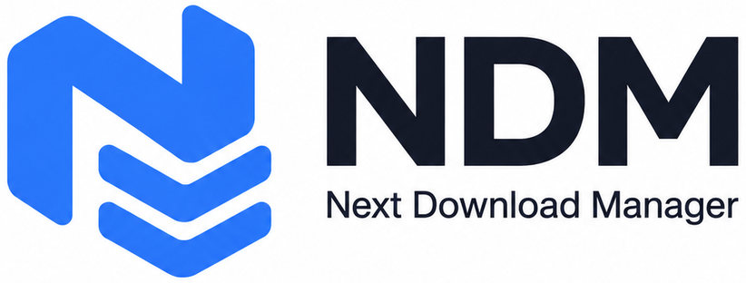
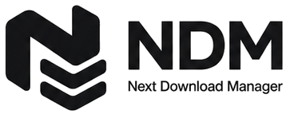

# NDM — Next Download Manager



Windows 10/11 x64 direct-download manager with an Android companion (Android 8+). Development alpha.
The Rust engine and SQLite queue are separate from the Tauri 2 / TypeScript UI.
English is the default; Persian changes the layout to RTL and uses Vazirmatn.
The successful hosted build and downloadable artifacts are recorded in
[build evidence](docs/BUILD_REPORT.md).

## Builds on GitHub

Download the [latest release](https://github.com/YeloBoi/next-download-manager/releases/latest)
from **Releases → Assets**. For installation, choose
the Windows x64 `*-setup.exe` installer or `*-android.apk` for Android. The portable ZIP, Chromium and Firefox extensions,
SHA256SUMS and release notes are separate assets.

All dependency installation, Rust compilation, tests and packaging run in
**GitHub Actions → Windows checks and build**. No local build is required.
After a successful run, choose only the artifact you need: `ndm-installer-windows-x64`,
`ndm-portable-windows-x64`, `ndm-chromium-extension`, `ndm-firefox-extension` or `ndm-checksums-and-notes`.
Installer and portable downloads are separated to avoid downloading both binaries.
Unsigned alpha binaries may trigger Windows reputation warnings; no code-signing
certificate is configured. Keep Windows security protections enabled.

Extract the portable ZIP and run `ndm.exe`, or run the per-user installer.
Microsoft Edge WebView2 Runtime is required; the installer can fetch it if missing.
Portable means the executables are carried together; settings and partial files
still live in `%LOCALAPPDATA%\NDM`, not beside the executable.

## Use

Add an HTTP(S) direct file URL, review the file and suggested destination, then select **Download now**
or **Add to queue**. Add multiple URLs one per line. The default queue is FIFO
with one file and one connection. Settings control concurrent files, connections
per file, host/global ceilings, speed, recovery and a local-time schedule.

Pause keeps partial bytes and pauses queue scheduling by default. **Pause &
continue queue** pauses only the selected file. Stop retains data and requires
explicit resume. **Stop after current** lets active jobs finish. **Download next**
reorders waiting work without interrupting active downloads. Restart and file
deletion require confirmation. Existing destination files are not overwritten.

Resume requires actual validated byte ranges plus a matching strong ETag or
Last-Modified. If safe resume is unavailable, NDM preserves the bytes and asks
for an explicit restart. Unknown sizes show no invented percentage or ETA.
Downloaded programs are never run automatically.

In **Settings → Your phone**, enable the LAN connection and show a one-time QR.
Open **PC → Scan QR code** in NDM on Android, with both devices on the same network.
Allow NDM through Windows Firewall on private networks if prompted. Use **PC** for remote
control and **Files** to accept and send files. Android’s share menu also has **Share to PC**
for links and files. The PC saves received files under **NDM Shared** in the configured
downloads destination. Use **Watch in background** on Android for completion notifications
while the app is not on screen.

**Download usage** compares completed PC and phone internet downloads. It keeps local
file transfers out of these totals and starts collecting statistics with this version.
The Windows update banner checks GitHub for a newer release. Portable users replace
their archive from Releases; installed copies can download a verified installer directly.
See the [Persian companion guide](docs/COMPANION.fa.md).

## Browser extension

See [extension setup](docs/EXTENSION.md). Load `chromium.zip` unpacked in Chrome
or Edge, or load `firefox.zip` as a temporary add-on in Firefox. The installer
or the first launch of portable NDM registers the connection automatically for
all three. Only links you select and send are shared with NDM.

[راهنمای فارسی نصب و اتصال افزونه](docs/EXTENSION.fa.md)

## Development (optional, not run on the owner's computer)

Requires stable Rust with MSVC, Visual Studio C++ Build Tools and Windows SDK,
Node 24, and WebView2. CI installs these on a hosted Windows runner.

```powershell
npm ci --include=optional
npm run check
npm run build
cargo fmt --all --check
cargo check --workspace --locked
cargo clippy --workspace --all-targets --locked -- -D warnings
cargo test --workspace --locked
npm run desktop
```

`scripts/Build-Artifacts.ps1` builds packages on a Windows runner. Rust and npm
lockfiles are committed. `npm run dev` is a UI preview only; it does not simulate
downloads or insert sample files. No screenshots are claimed until the real
desktop app has been exercised and captured.

## Status and limitations

See the [complete implementation ledger and milestones](docs/IMPLEMENTATION_STATUS.md),
[acceptance status](docs/STATUS.md), [architecture](docs/ARCHITECTURE.md) and
[release notes](docs/RELEASE_NOTES.md). CI success is not proof of interactive
desktop behavior, correct RTL rendering, clean-machine installation or complete
crash resilience. These remain unverified acceptance criteria for this development alpha.

There is no telemetry, DRM bypass, page-video extraction or support for arbitrary
authenticated browser sessions. Auto connection tuning, notifications, sleep
prevention, automatic categorization, expired-link replacement, clipboard watching
and shutdown-after-queue are not implemented. The mobile app is Android only. PC
control and file sharing require the PC application to be running on the same local network.

The owner requested removal of the draft project LICENSE and authorized public
source and alpha binaries. No replacement license is added. Third-party licenses
and notices remain applicable; see [THIRD_PARTY_NOTICES.md](THIRD_PARTY_NOTICES.md).
The NDM name is provisional; trademark and product-name availability have not
been established.

The supplied logo variants are cropped for their actual contexts: desktop and
installer icons, theme-aware sidebar, custom titlebar, browser extension and docs.
See [brand assets](docs/BRAND.md) for the crop map.


